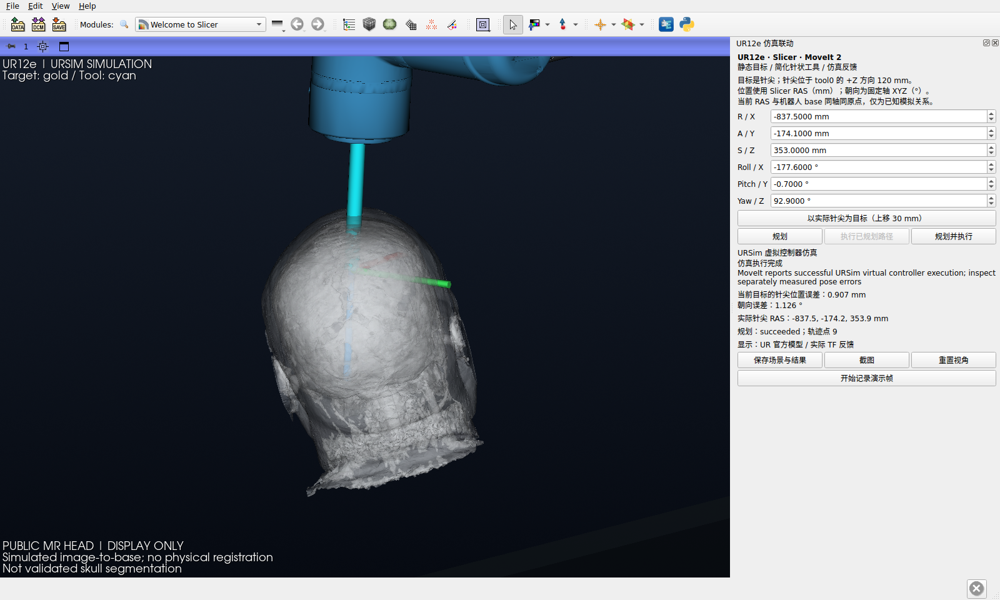

# 给 GPT 的项目上下文：截至 2026-10-31

这份文件用于解释“项目在做什么、最近推进了什么、现在能做到哪一步”。先读本文，再按链接查看源码和精选证据。这里的历史运行不是打开仓库时的实时状态；当前进程是否运行应另查 status。开发和执行约定见 [AGENTS.md](AGENTS.md)。

## 1. 我们的目标和本周要求

长期目标是把头部影像、目标点、配准、定位观测与机械臂控制串起来，在 Slicer 中显示并评价导航过程。近期先在本机把软件环境准备好，减少到实验室后的部署时间。

博士生给机器人组的本周要求是：搭建 URSim，在仿真环境里编写、调试并跑通基础控制程序。已确认可以沿用 ROS 2 / MoveIt；URSim 自行下载；实验室真机安装了 External Control 1.0.5。真机照片组件号与可下载 URSim 包的准确对应关系尚未确认。

## 2. 各软件在这里做什么

| 部分 | 通俗理解 | 仓库中的职责 |
|---|---|---|
| Slicer | 看影像、放目标和观察运动的操作台 | 头部显示、针尖目标、规划预览、执行按钮和误差显示 |
| 文件桥 | 操作台与机器人程序之间的传话渠道 | 将目标发送给 ROS，并接收状态、关节、工具位置和结果 |
| ROS 2 / MoveIt 2 | 控制程序与路径规划部分 | 计算关节路径、调用执行 action、读取关节与 TF |
| URSim | 电脑里的 UR 虚拟控制柜和示教器 | 接收 UR 官方驱动指令，通过 External Control 运行外部程序 |
| mock hardware | 先把软件流程接通的模拟硬件后端 | 既有导航评价主线；其通过不自动证明 URSim 或真机通过 |

当前 URSim 链路是：**Slicer 目标 → 文件桥 → MoveIt 规划 → UR 官方驱动 / External Control → URSim → 关节 / TF → Slicer**。URSim 使用 PolyScope 5.23.0、External Control 1.0.5；Linux 环境是 Ubuntu 24.04、ROS 2 Jazzy，Slicer 为 5.12.4。实际运行证据来自 Windows 宿主下的 WSL2 / WSLg，没有冒充另一台全新原生 Linux 机器的验证。

## 3. 最近具体完成了什么

### 之前：mock 机器人与头部导航

已完成 Slicer 与 MoveIt/mock 的目标、规划、执行、反馈闭环；加入公共 MR 头部、模拟坐标变换、合成配准点 / 检查点和模拟光学观测。历史完整软件评价包含 72 项离线场景、3 个 MoveIt/mock 执行场景、6 类执行前拒绝。见 [10 月 24 日参考证据](ur12e_slicer/reference_results/2026-10-24-linux/PROVENANCE.md)。

### 10 月 27 日：加入 URSim 虚拟控制柜

1. 准备官方固定镜像和 External Control 1.0.5，保存虚拟示教器配置，启用 Remote Control。
2. 新增独立 URSim 启动、状态、运行验收、停止入口；保留 mock 默认入口，两种后端不同时运行。
3. 使用 scaled joint trajectory controller 完成关节动作和 MoveIt 针尖目标执行；Slicer 能看到来自 `ros2_ursim` 的实时反馈。
4. 增加 Windows / WSL 一键启停和会话守护；重复启动复用已有 guardian，停止后确认其退出。
5. 处理 WSL 共享文件瞬态、重复校时造成的时间回退、跨文件系统归档权限问题。高频控制与原始日志放原生 Linux cache；结果归档核对 SHA256。保持原有反馈有效性和误差判据。

正式轮 `20261027T044855Z_f8a2ba` 的**基础控制 5/5、Slicer 21/21、停止后无本任务活动残留**。这是一轮历史通过记录；停止日志仍有 Docker 137、MoveIt -11、ros2_control -15 等异常退出，不能写成所有组件正常退出。详细过程见 [10 月 27 日记录](ur12e_slicer/URSIM_RESULTS_2026-10-27.md)。

### 10 月 31 日：再次演示，发现录帧不稳定

当天实际复跑两轮，基础控制均 5/5。两轮 Slicer 都为 **20/21**：目标对应、规划、执行、运动观测、误差和保持反馈通过，但只录到 **19 帧**，低于至少 20 帧的要求。因此两轮外层 `passed=false`，没有放宽阈值或把失败写成全通过。

| 日期 / 轮次 | 基础控制 | Slicer | 最终针尖位置残差 | 最终朝向残差 | 录帧 |
|---|---|---|---|---|---|
| 10-27 完整轮 | 5/5 | 21/21 | 1.705336 mm | 0.757229° | 20 |
| 10-31 第一轮 | 5/5 | 20/21 | 1.435203 mm | 1.108114° | 19，未达要求 |
| 10-31 第二轮 | 5/5 | 20/21 | 0.906986 mm | 1.125797° | 19，未达要求 |

表中位置 / 朝向为 Slicer 最终结果；5 项基础控制有各自的结果，不能混用。残差来自虚拟模型反馈的计算，不是实体定位仪或真机精度测量。[三轮精选 JSON 与来源](ur12e_slicer/reference_results/2026-10-31-ursim/README.md)已公开到本仓库。

### 头部为什么一度不显示，后来怎么恢复

URSim 基础控制入口默认只加载机械臂。它没有自动加载之前的头部导航场景，所以当时展示的画面没有头部；数据和显示代码仍然保留。

随后通过本任务 Slicer 队列加载原公共 MR 及其表面，沿用旧示例的模拟影像到机器人坐标变换。机器人仍由当前 URSim 关节 / TF 驱动；只恢复显示，没有发送运动命令，也没有将旧 mock 的导航成绩当作 URSim 成绩。

图中灰白色是 **MR 强度等值面**，尚未经头皮 / 颅骨分割审核；青色是 `tool0` 局部 +Z 120 mm 的简化工具。头模可见不代表已完成物理配准、碰撞建模或穿刺深度验证。该表面没有作为 MoveIt 的头部碰撞障碍物。

本次恢复是当前会话中的显示操作，**默认 URSim 启动仍不自动带头部**。当时使用的 [显示脚本](ur12e_slicer/reference_results/2026-10-31-ursim/head-display/show_head_display.py)随精选证据保留，依赖现有导航示例结果和已启动的本任务 Slicer / URSim；不是独立安装或导航验收入口。

## 4. 当前还没有完成什么

- 修复录帧稳定性，并重新取得一次可重复的完整 URSim 验收通过。
- 将头部显示整理成常规 URSim 使用流程，再在 URSim 上重跑整套头部导航、误差注入和拒绝场景。目前只恢复显示。
- 审核解剖分割、建立合适的碰撞模型与工具模型；当前 MR 表面和针仅作软件仿真。
- 真机及光学定位仪联调、真实机器人校准、工具 TCP / 负载、实验室网络与现场操作条件确认。尚不能承诺到实验室插线即用。
- 物理独立计量、临床效果、ASTM 合规和与其他平台的匹配条件性能比较。

## 5. 让 GPT 怎样读最省事

本次发布前以普通 Linux 用户复查了 74 项离线检查：bridge 18、URSim lifecycle 26、guardian 6、validator 24，均通过。[完整日志](ur12e_slicer/reference_results/2026-10-31-ursim/publication/offline_checks.log)随精选证据保留；这些检查未启动 ROS / Slicer / Docker，也不能替代上述实际运动结果。发布检查另核对来源哈希、JSON 数值 / 布尔字段保持一致和文件白名单。

阅读顺序：本文 → [精选结果说明](ur12e_slicer/reference_results/2026-10-31-ursim/README.md) → [URSim 部署说明](ur12e_slicer/URSIM_LINUX.md) → 按需要看 [桥协议](ur12e_slicer/protocol.md)和源码。

可以把下面这段话和本文件链接一起发给 GPT：

> 请先读 PROJECT_CONTEXT.md，再核对链接里的三轮 JSON。用通俗中文解释：项目的目的；Slicer、ROS 2、MoveIt、URSim 如何配合；相较之前 mock 新增了什么；10 月 27 日通过与 10 月 31 日未全通过分别说明什么；头部显示恢复到了哪一步；下一步优先解决什么。请把已实跑、仅显示、计划中和真机尚未验证分开说明。

本仓库发布源码、说明、少量带来源哈希的结果和截图；安装包、Docker 层、原始大量录帧、MRB、个人路径与运行时通信不在本次提交中。精选结果是历史证据，不随当前应用界面实时更新。
