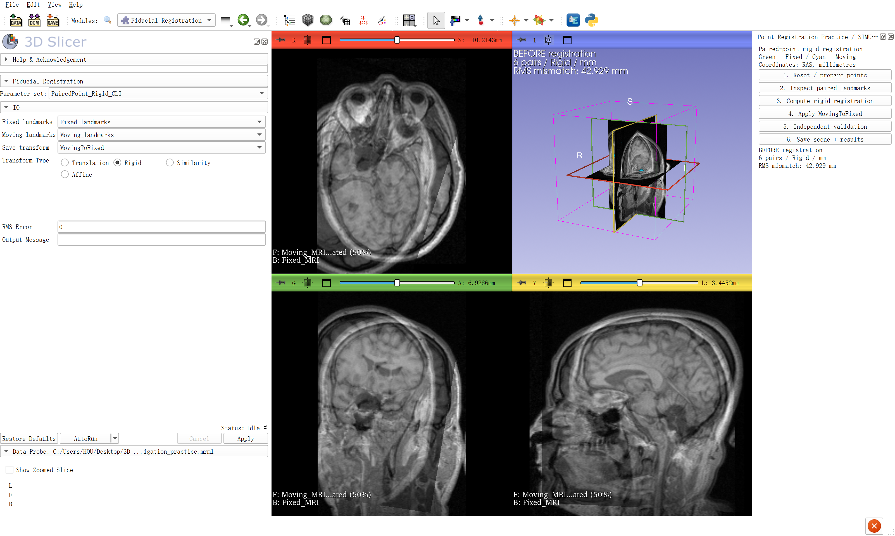
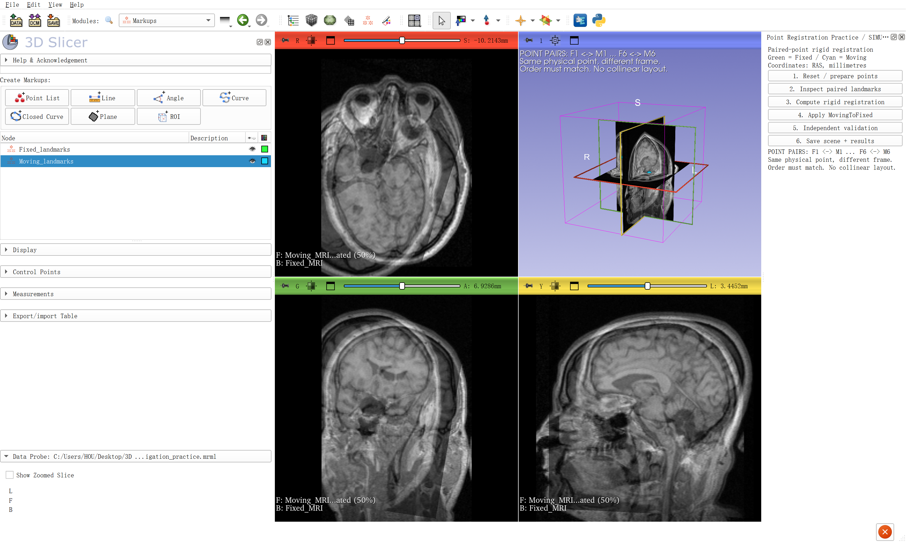
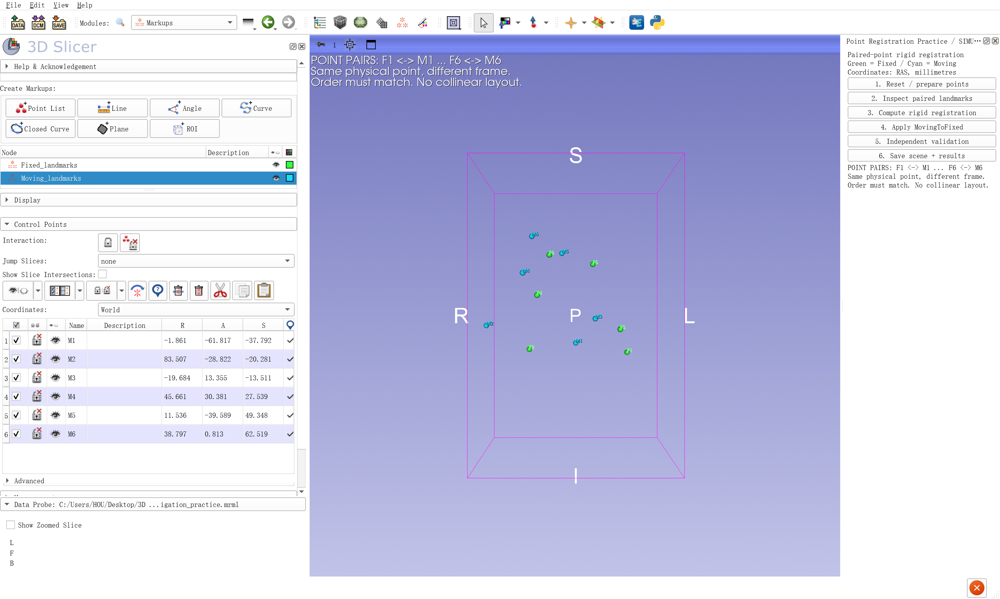
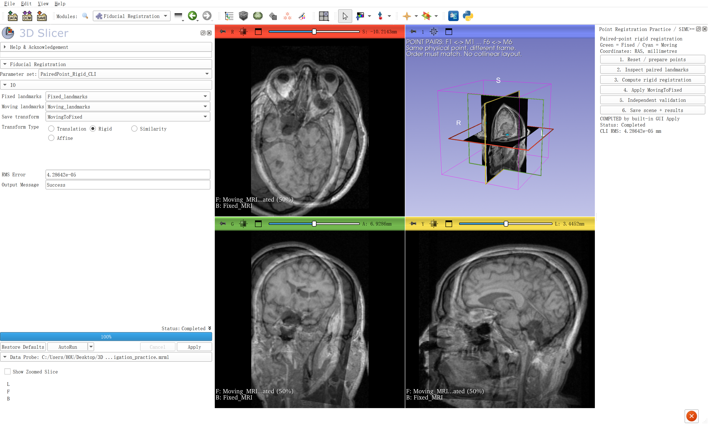
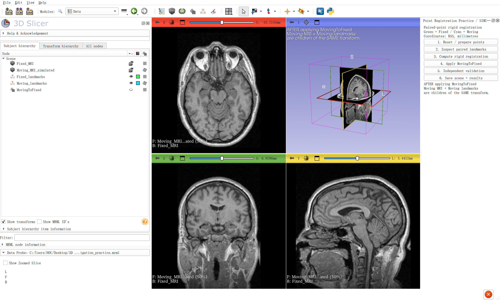
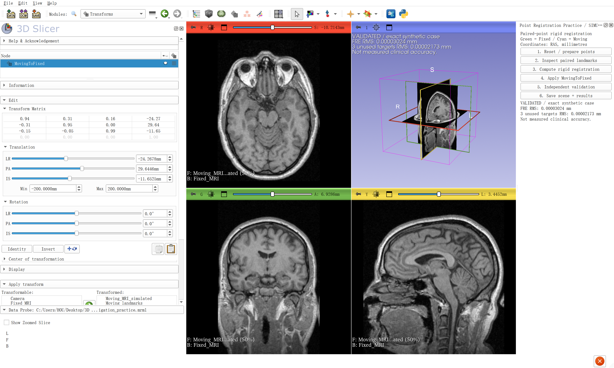

# 3D Slicer 模拟点配准：实操、截图与复现

日期：2026-10-17。环境：本仓库 Windows 版 3D Slicer 5.12.4，内置 **Fiducial Registration** 模块。本次未安装额外配准扩展。

## 本次实际完成了什么

建立 6 对对应点，在 Slicer 内置配准界面点击 **Apply** 计算刚性变换，将变换同时应用于 Moving 点集和 Moving 影像，再检查独立点。保存了 7 张真实软件截图、配准前后两份 MRB 场景、点坐标 CSV、变换和数值结果；两份场景均实际重新加载验证。

本练习使用仓库已有的公开 MRI 示例。Moving 影像是同一影像的复制品，通过改变空间几何制造错位；Moving 点也由同一已知刚性变换生成。标记点是教学用的合成坐标，没有人工识别解剖标志，也没有采集真实患者或光学定位数据。它验证的是**对应点、变换方向和应用流程**。

## 先理解这三个对象

| 对象 | 含义 | 本练习名称 |
|---|---|---|
| Fixed | 希望保持不动的参考坐标系 | `Fixed_MRI`、`Fixed_landmarks` |
| Moving | 当前错位、需要变换的数据 | `Moving_MRI_simulated`、`Moving_landmarks` |
| MovingToFixed | 把 Moving 坐标转换到 Fixed 坐标的规则 | 4×4 刚性变换节点 |

F1 与 M1 表示“同一个点在两套坐标中的位置”，F2 对应 M2，以此类推。配准求的是 `p_fixed ≈ T_moving_to_fixed × p_moving`。刚性变换允许旋转和平移，不改变物体大小或形状。至少需要 3 对不共线的点；本次用 6 对分布在三维空间中的点，避免挤在一个小区域。[官方配准模块说明](https://slicer.readthedocs.io/en/latest/user_guide/modules/fiducialregistration.html)、[Horn 的点配准论文](https://people.csail.mit.edu/bkph/papers/Absolute_Orientation_Scanned.pdf)。

## 路线 A：打开现成练习，自己完整跑一遍

1. 双击根目录的 [`Open_Registration_Practice.cmd`](../Open_Registration_Practice.cmd)。它打开新 Slicer 窗口，加载 MRI 并准备 6 对点；右侧是本次新增的教学按钮。
2. 点击右侧 **2. Inspect paired landmarks**。在 Markups 中选择 Fixed 或 Moving，展开 **Control Points**，检查 F1↔M1…F6↔M6 的顺序和 R/A/S 坐标。
3. 在顶部模块搜索中查找 **Fiducial Registration**，选择本次参数集 `PairedPoint_Rigid_CLI`。核对四项：

   | 界面项 | 选择 |
   |---|---|
   | Fixed landmarks | `Fixed_landmarks` |
   | Moving landmarks | `Moving_landmarks` |
   | Save transform | `MovingToFixed` |
   | Transform Type | **Rigid** |

4. 点击**内置模块左下方的 Apply**，等状态变为 `Completed`，查看 RMS Error。右侧 **3. Compute rigid registration** 按钮是调用同一内置模块的快捷方式；初次练习建议自己操作内置界面。
5. 应用变换。最方便的方式是点击右侧 **4. Apply MovingToFixed**。想学会原生操作时，进入 **Transforms**，选中 `MovingToFixed`，在 **Apply transform** 中，把 `Moving_landmarks` 和 `Moving_MRI_simulated` 从 Transformable 移到 Transformed。也可以在 Data 树中将这两个节点放到该变换下面。**Fixed 点和 Fixed 影像保持在变换之外。**
6. 在 Data 中确认两个 Moving 节点共用同一个父变换；再观察三个切面中的影像重影是否消失、点是否重合。
7. 点击右侧 **5. Independent validation**，检查配准点误差及 3 个未参加求解的目标点误差；点击 **6. Save scene + results** 保存当前结果。

右侧“1”会重建本练习并丢弃这个练习窗口中未保存的修改，因此应在单独练习窗口使用。需要重来时，先保存自己的修改，再重置。不要在已经应用变换的 Moving 点上直接再次运行原生配准，否则求解器读到的可能是已对齐的世界坐标；应先移除两个 Moving 节点的父变换。右侧“3”已处理这一步。

## 路线 B：用保存场景练习，不依赖教学面板

在一个新 Slicer 窗口加载 [`PointRegistration_before.mrb`](../output/registration_2026-10-17/PointRegistration_before.mrb)，按上述第 3～6 步操作，即可用 Slicer 原生模块完成配准。MRB 保存数据与节点，**不会自动重建自定义教学按钮**。

[`PointRegistration_after.mrb`](../output/registration_2026-10-17/PointRegistration_after.mrb) 是完成后的参考场景，可用于查看节点层级、变换矩阵及影像对齐效果。重新加载场景后，CLI 运行状态可能恢复为 `Idle`，这不等于已保存的变换失效；应检查变换及误差。重新练习应加载 before 场景。

## 路线 C：自己新建点集

在 Markups 中创建两个 **Point List**，分别命名为 Fixed_landmarks、Moving_landmarks，各添加 6 个点，在 Control Points 表中录入下表。检查列标题为 **R、A、S**，单位 mm；这里使用的是三维物理坐标，不是影像的 I/J/K 像素序号。

| 对应点 | Fixed R | Fixed A | Fixed S | Moving R | Moving A | Moving S |
|---|---:|---:|---:|---:|---:|---:|
| 1 | -50.795 | -28.571 | -45.714 | -1.861 | -61.817 | -37.792 |
| 2 | 42.205 | -23.571 | -42.714 | 83.507 | -28.822 | -20.281 |
| 3 | -40.795 | 48.429 | -22.714 | -19.684 | 13.355 | -13.511 |
| 4 | 32.205 | 44.429 | 7.286 | 45.661 | 30.381 | 27.539 |
| 5 | -17.795 | -11.571 | 37.286 | 11.536 | -39.589 | 49.348 |
| 6 | 22.205 | 18.429 | 44.286 | 38.797 | 0.813 | 62.519 |

完整精度保存在 [`point_pairs_RAS_mm.csv`](../output/registration_2026-10-17/point_pairs_RAS_mm.csv)。表格四舍五入后，手工练习结果与下方完整精度结果会有细微差别，不应要求小数位完全一致。仅点集也可以配准；要观察影像一起移动，需要保证影像和对应点原本就在同一坐标空间中。

## 关键步骤截图

### 1. 配准前：影像错位，输入和输出参数已经选好

Fixed 与 Moving MRI 以 50% 前景叠加，能看到重影。界面中的 RMS Error 默认 0 是**尚未计算的初始值**；本次计算前真实点对 RMS 距离是 42.928806 mm。

### 2. 对应点：两份列表与点序

为看清点坐标和空间错位，另保存了一张隐藏切片平面的三维视图。绿色是 Fixed，青色是 Moving；此时 Moving 点没有父变换。

### 3. 求解完成：输出刚性变换

这一步实际点击了内置模块的 Apply。状态为 Completed，但影像仍然错位，因为变换尚未应用到 Moving 数据。

### 4. 应用变换：检查父子关系与影像重合

下图为 Data 的 Subject hierarchy 页：Moving 节点右侧的变换标识表明它们已应用变换。要直接看父子树，切到旁边的 **Transform hierarchy**；下一张 Transforms 截图的 **Transformed** 列表也列出了两个 Moving 节点。

### 5. 验证：矩阵、配准点与独立检查点

## 实测结果与边界

原始记录：[`results.json`](../output/registration_2026-10-17/results.json)。配准点 RMS 使用 6 对点的三维欧氏距离计算；独立目标 RMS 使用另外 3 对没有参与拟合的合成点计算。

| 检查项 | 结果 |
|---|---:|
| 配准前对应点 RMS 距离 | 42.928806 mm |
| 内置 CLI 显示的 RMS Error | 0.0000428642 mm |
| 用场景中的完整精度坐标重算 FRE RMS | 约 0.00003024 mm |
| 3 个独立目标的 RMS 误差 | 约 0.00002173 mm |
| 两份 MRB 重新加载 | 均成功，变换层级与误差符合预期 |

CLI 输出与完整精度重算均接近数值零，末位有差别；CLI 点参数传递时的数值精度与内存坐标并不完全相同。本次没有进一步单独测量各数值环节的误差贡献。**这些微小数值不表示现实导航能达到这样的精度。**

补充对照也在 Slicer 内调用同一个配准模块完成，随机种子固定为 20261017；不是统计性精度研究：

| 对照 | 配准点 FRE RMS | 独立目标 RMS | 说明 |
|---|---:|---:|---|
| Moving 点各坐标加入标准差 0.8 mm 的高斯噪声 | 1.0791 mm | 0.3233 mm | 测量噪声使拟合误差不再接近零 |
| Moving 前三点顺序循环错配 | 46.3211 mm | 26.2589 mm | 仍可显示 Completed，但配准质量很差 |

独立点误差与 FRE 数值不同是正常的，二者测量对象不同；不能拿一次模拟的比例推广到真实系统。[Fitzpatrick 等关于 FRE/TRE 的研究](https://pubmed.ncbi.nlm.nih.gov/9874293/)说明了为什么应关注目标处误差及标志点布局。

## 最容易操作错的地方

- Fixed/Moving 反了：求得的是相反方向。先写清楚“谁变到谁”。
- 两份列表点数一样但顺序不对应：算法不会替你判断哪个点代表同一个物理位置。
- 只算变换，没有应用：Completed 并不意味着影像已经移动。
- 点被移动，影像没移动：检查两个 Moving 节点是否都在同一变换下面。
- 把 Fixed 也放进变换：参考系跟着变了。
- 为追求更小残差随意改用 Affine：缩放和剪切可能掩盖真实的刚性配准问题。
- 把 RAS/LPS 或 mm/m 混用：先核对坐标约定与单位。[Slicer 坐标系统说明](https://slicer.readthedocs.io/en/5.10/user_guide/coordinate_systems.html)。

## 文件与脚本

- [`registration_practice.py`](../scripts/registration_practice.py)：场景、点集、配准、变换应用、独立验证和教学按钮。
- [`start_registration.py`](../scripts/start_registration.py)：专用启动入口。
- [`registration_extra_checks.py`](../scripts/registration_extra_checks.py)：带噪声与错配对照、点云截图、场景重载验证。应在已完成基础配准的教学实例中运行。
- `Fixed_landmarks.mrk.json`、`Moving_landmarks.mrk.json`：原始点集；单独加载 Moving 点文件时不会自动恢复父变换，请优先使用 MRB。
- `MovingToFixed.h5`：保存的空间变换。跨软件传递时还需核对文件的坐标约定。

后续机器人/定位整合与论文资料见 [项目调研](项目调研_配准与机器人导航_2026-10-17.md)。
