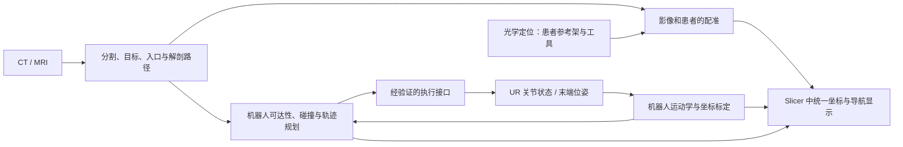

# 配准、手术导航与 UR 机械臂整合：入门调研

检索日期：**2026-10-17**。对应课堂作业（三）-（2）；实操证据见 [模拟点配准实践](模拟点配准实践_2026-10-17.md)。本文供理解项目、选择方向和后续制作汇报使用，未制作 PPT。

## 先抓住整个项目在做什么

目标可以概括成：**在医学影像里确定目标与路径，把影像中的位置对应到现实患者和机器人，再持续显示工具、机械臂以及路径之间的关系。**

例如，MRI 中选定了一个目标，但这个点的数字坐标不能直接发给 UR 机械臂。MRI、患者参考架、光学相机、机器人底座和工具尖端各有自己的坐标系；必须知道这些坐标系之间的变换，才能回答“工具现在在影像的哪里”“距离目标多远”“机器人应该到哪个位置”。



图中是**根据课堂需求和文献提出的系统划分**。目前本仓库实际完成的是影像练习、模拟工具与模拟点配准，还没有接入光学定位或 UR 机械臂；图里的整套链路尚未实现。

## 配准、标定、跟踪分别解决什么

| 名词 | 通俗解释 | 输入 → 输出 | 项目中的例子 |
|---|---|---|---|
| 影像—影像配准 | 同一部位的两套影像对齐 | 两幅影像 → 空间变换 | 同一患者 CT 与 MRI 对齐 |
| 点配准 | 同一组物理点在两套坐标中的位置对齐 | 成对三维点 → 刚性变换 | 影像标志点与探针采集点对应 |
| 工具标定 | 确定“标记架”和“真正尖端”之间的固定关系 | 多次工具姿态/观测 → 固定偏移 | 光学系统看见工具架，但导航需要尖端位置 |
| 机器人相关标定 | 确定底座、法兰、工具、跟踪器等坐标的关系 | 机器人位姿与外部观测 → 坐标变换 | UR 底座对应到光学相机坐标 |
| 实时跟踪 | 持续测量当前位置，而非只对齐一次 | 带时间信息的位姿序列 → 当前状态 | 工具移动、患者参考架移动 |
| 路径/轨迹规划 | 求满足约束的运动过程 | 目标、几何、关节约束 → 路径及时间安排 | 机械臂怎样到达入口且避开周围物体 |

点配准和手眼标定都涉及刚性变换，但实验布置与未知量不同，不能因为两者都输出 4×4 矩阵就互相代替。工具尖端标定、机器人运动学校准、影像—患者配准也应分别记录和验证。[点配准研究](https://people.csail.mit.edu/bkph/papers/Absolute_Orientation_Scanned.pdf)、[手眼标定研究](https://kmlee.gatech.edu/me6406/handeye.pdf)、[Plus 官方介绍](https://plustoolkit.github.io/about.html)。

## 常见的医学配准方法

| 方法 | 大致怎么做 | 适用情形 | 主要限制与本项目关系 |
|---|---|---|---|
| 刚性点配准 | 已知对应点，求旋转和平移，使点对尽量重合 | 标志点、模体、相对刚性的解剖结构 | 依赖点顺序、点定位精度和空间分布；本次已实践 |
| 表面配准 / ICP | 在两表面间寻找近邻，再迭代调整姿态 | 扫描表面与影像重建表面匹配 | 初值、遮挡、局部相似结构会影响结果；常用点配准做初始化 |
| 基于灰度的配准 | 调整变换，让两幅图像的相似性指标更好 | 同一患者多次扫描或 CT/MRI 等多模态影像 | 常需合理初始对齐、合适指标与掩膜；互信息是常用跨模态指标 |
| 非刚性配准 | 给不同位置不同位移，描述局部形变 | 软组织、跨个体配准、术前术中变化 | 不能用一个刚性矩阵表达；需要额外质量检查 |
| 学习式配准 | 用网络从图像对预测形变 | 大量重复的图像配准任务 | 依赖训练数据、模态和泛化；不是目前设备整合的先决条件 |

来源：[Slicer 配准总览](https://slicer.readthedocs.io/en/5.8/user_guide/registration.html)、[BRAINSFit 官方说明](https://slicer.readthedocs.io/en/latest/user_guide/modules/brainsfit.html)、[ICP 原论文](https://graphics.stanford.edu/courses/cs348a-21-winter/Handouts/Besl92.pdf)、[VoxelMorph 作者论文](https://arxiv.org/abs/1809.05231)。

当前优先理解刚性点配准。对头颅相关系统，刚性模型是建立坐标关系的基础，但不能据此认为术中脑组织一直不变形；脑移位等问题属于后续需要单独处理的误差来源。当前资料未明确本项目具体手术操作，因此不先指定非刚性算法。

### 怎样判断配准好不好

- **FLE（标志点定位误差）**：点在影像中或现实中被定位时的偏差。
- **FRE（标志点配准误差）**：用于求解的点对，在配准后还差多远；本次报告 RMS。
- **TRE（目标配准误差）**：目标位置在配准后还差多远，目标没有参加拟合。

FRE 小不保证目标附近 TRE 小，点的布局和目标相对位置也有影响。因此要留出独立检查点，实际项目还要在目标相关区域验证。上述关系可读 [Fitzpatrick、West、Maurer，1998](https://pubmed.ncbi.nlm.nih.gov/9874293/)。本次合成练习既报告 FRE，也报告 3 个独立目标误差；它们不能替代真实硬件与真实目标处的验证。

## 光学定位怎样进入 Slicer

一个常见研究架构是：**定位设备 → 采集/标定软件（如 Plus）→ OpenIGTLink → Slicer 中的变换节点 → 虚拟工具和切片显示**。[Plus 官方说明](https://plustoolkit.github.io/about.html)、[SlicerIGT 项目与教程](https://www.slicerigt.org/wp/)。

光学相机通常观测的是刚性标记架。要显示工具尖端，还需要标记架到尖端的标定；要在患者移动时保持位置对应，还需要患者参考架及其坐标链。某型号设备是否受支持，要查该设备 SDK 与 Plus 对应驱动，不能只凭“支持光学定位”推定兼容。

用一个统一记号说明方向：`T_A_B` 表示**将 B 坐标中的点变成 A 坐标中的点**。设 I=影像、P=患者参考架、C=光学相机、M=工具标记架、Tip=工具尖端，则一种导航链为：

```text
p_I = T_I_P × inverse(T_C_P) × T_C_M × p_M_tip
```

其中 `T_I_P` 来自配准，`T_C_P` 和 `T_C_M` 来自实时跟踪，`p_M_tip` 来自工具标定。乘法从右往左执行。它展示的是坐标关系，**不是本项目已经接通的设备协议**。

后续接入时要检查方向、RAS/LPS、mm/m、工具尖端定义、时间戳及跟踪是否有效。相机看到两个标记架，也不自动代表尖端位置正确。Slicer 使用的坐标与文件转换约定见 [官方坐标系统](https://slicer.readthedocs.io/en/5.10/user_guide/coordinate_systems.html)。

## UR 机械臂主要要接入哪些内容

| 内容 | 为什么需要 | 可参考的现成接口 |
|---|---|---|
| 实际关节位置 | 更新各连杆，显示完整机械臂形态 | UR ROS 2 Driver、`joint_states`、URDF、TF2 |
| 实际 TCP 位姿 | 显示末端位置与姿态 | UR RTDE 的 `actual_TCP_pose` |
| 机器人模型 | 关节和几何模型对应起来 | URDF 与网格文件 |
| 底座及工具关系 | 把机器人坐标接到影像/患者坐标链 | 外部标定、TCP 定义、机身运动学校准 |
| 运动规划与控制 | 把目标变成可达、可执行的运动 | MoveIt 2、ROS 2 控制器与 UR 驱动 |

来源：[UR 官方 ROS 2 Driver 启动说明](https://docs.universal-robots.com/Universal_Robots_ROS2_Documentation/doc/ur_robot_driver/ur_robot_driver/doc/usage/startup.html)、[UR 官方 RTDE 文档](https://www.universal-robots.com/manuals/EN/HTML/SW10_10/Content/Prod-RTDE/Real_Time_Data_Exchange_RTDE.htm)、[SlicerROS2 机器人显示教程](https://slicer-ros2.readthedocs.io/en/v1.2/pages/robot-visualization.html)。

**只拿到末端位姿，不能唯一恢复整条机械臂的关节状态。** 要显示实际连杆姿态，应使用实际关节反馈和正确运动学模型；逆运动学可能存在多个解。UR 的 `actual_TCP_pose` 中后三项是**旋转向量**，不是三个欧拉角，转换接口时必须按文档解释。

UR 自身的运动学校准参数也需要与设备匹配。它改善机器人模型与实际机器人的一致性，但不会自动完成影像—患者或底座—相机之间的标定。[UR 官方设备准备说明](https://docs.universal-robots.com/Universal_Robots_ROS2_Documentation/doc/ur_robot_driver/ur_robot_driver/doc/installation/robot_setup.html)。

## “手术路径”与“机械臂运动路径”是两层任务

**解剖路径层**解决：从哪个入口到哪个目标，怎样避开血管、重要组织等。常见研究把目标、候选入口、危险结构距离、路径长度、入射角等变成约束或评价指标。SEEG 多电极规划还要处理电极之间冲突。[Sparks 等的多路径规划论文](https://pubmed.ncbi.nlm.nih.gov/27368184/)。

**机器人运动层**解决：机械臂能否达到相应位姿，各关节是否越界，运动过程中是否与自己、床、患者模型或其他器械相撞，以及怎样安排速度和加速度。[MoveIt 运动规划说明](https://moveit.picknik.ai/main/doc/concepts/motion_planning.html)。

| 常见方法/工具 | 主要用途 | 初学时需要知道的边界 |
|---|---|---|
| 入口—目标直线、候选入口筛选 | 穿刺/电极等直线通道的解剖规划 | 直线没有碰到解剖障碍，不代表机械臂所有连杆都可达且无碰撞 |
| RRT / RRTConnect / PRM | 在机器人配置空间搜索可行路径 | 结果依赖约束、碰撞模型和时间预算 |
| RRT* / PRM* | 进一步考虑路径代价的渐近优化 | 渐近最优不等于有限时间内一定最优，也不是临床安全保证 |
| Pilz PTP / LIN / CIRC | 点到点、直线、圆弧等工业运动形式 | 运动形式的定义不等于自动找到绕障路径 |
| MoveIt Planning Scene | 提供障碍物、机器人和附着工具的碰撞几何 | 必须把正确的解剖/环境几何和坐标变换传进去 |

来源：[OMPL 算法列表](https://ompl.kavrakilab.org/planners.html)、[Karaman 与 Frazzoli 原论文](https://arxiv.org/abs/1105.1186)、[Pilz 官方教程](https://moveit.picknik.ai/main/doc/how_to_guides/pilz_industrial_motion_planner/pilz_industrial_motion_planner.html)。

对本项目的实现推断：先在 Slicer 选入口和目标、显示一条候选解剖路径，再交给机器人侧检查末端姿态、逆运动学、碰撞与轨迹。具体适用何种路径模型，要等实际手术任务明确后决定。

## Slicer 与机器人整合的两条常见实现路线

### 路线 A：外部 ROS 2，通过 OpenIGTLink 等接口连接 Slicer

Slicer 负责影像、分割和导航显示；外部机器人程序负责 UR 驱动、运动学与规划，中间传递带坐标定义的位姿、目标和路径。定位设备可以通过 Plus 接入。优点是模块边界清楚；实现时要补齐消息内容、单位、坐标系、时间戳、连接状态与命令确认。

这是基于 [SlicerIGT 架构资料](https://www.slicerigt.org/wp/)和 [SlicerROS2 论文对早期 ROS-IGTL 桥接方式的讨论](https://arxiv.org/html/2509.19076v1)作出的项目方案推断。OpenIGTLink 本身不是 UR 控制器，也不负责寻找机器人路径。

### 路线 B：SlicerROS2 直接连接 ROS 2

SlicerROS2 将 ROS 通信机制和 TF2 关系映射到 Slicer/MRML，利用机器人描述加载模型并更新姿态。2024 年论文还展示了与影像相关的路径传递和虚拟约束等研究案例。[作者公开稿](https://arxiv.org/html/2509.19076v1)、[官方代码](https://github.com/rosmed/slicer_ros2_module)。

**与本项目直接相关的新发现**：检索时的官方 v1.2 文档已有 **UR5 mock hardware + MoveIt + Slicer** 示例，以及 **把 Slicer 模型作为 MoveIt 障碍物**的例子。这为后续无真实机械臂的系统演示提供了具体参考。[UR 显示示例](https://slicer-ros2.readthedocs.io/en/v1.2/pages/robot-visualization.html)、[Slicer 模型转规划障碍物](https://slicer-ros2.readthedocs.io/en/v1.2/pages/examples/moveit_obstacle.html)。这些示例本轮只做资料核查，**尚未在本机运行**。

部署不能直接等同于“给当前 Windows Slicer 装一个普通插件”。本次读到的 **v1.2 Compatibility** 发布目标是 Ubuntu 24.04、ROS 2 Jazzy、从源码构建的 Slicer 5.10.0；本机是 Windows Slicer 5.12.4。后续要按选定版本重新核对环境，不把开发分支、历史版本与本机现状混在一起。[v1.2 兼容表](https://slicer-ros2.readthedocs.io/en/v1.2/pages/compatibility.html)、[构建说明](https://slicer-ros2.readthedocs.io/en/v1.2/pages/getting-started.html)。

## 代表论文：读哪篇、解决什么问题

以下是定向入门检索，并非系统综述或完整最新论文清单。优先选作者公开稿、论文出版/摘要页和官方项目资料。标注了本轮实际阅读层级；摘要级材料不据此推断具体实现、硬件兼容性或临床效果。

### P1｜点配准的基础：Horn，1987

**Closed-form solution of absolute orientation using unit quaternions.** B. K. P. Horn. *JOSA A*, 4(4):629–642. DOI：[10.1364/JOSAA.4.000629](https://doi.org/10.1364/JOSAA.4.000629)；[作者全文](https://people.csail.mit.edu/bkph/papers/Absolute_Orientation_Scanned.pdf)。

- 输入对应点，求两个坐标系之间的旋转、平移，论文也讨论尺度；提供闭式最小二乘求解思路。
- 对本项目：帮助理解本次点配准为什么能由几组点求出空间对应关系；不表示本次 Slicer 内部必然逐行采用这份实现。
- 阅读层级：核对原论文问题定义与方法概述，未逐式推导。

### P2｜误差怎么评估：Fitzpatrick、West、Maurer，1998

**Predicting error in rigid-body point-based registration.** *IEEE Transactions on Medical Imaging*, 17(5):694–702. DOI：[10.1109/42.736021](https://doi.org/10.1109/42.736021)；[论文摘要](https://pubmed.ncbi.nlm.nih.gov/9874293/)。

- 研究标志点误差、配准残差与目标处误差，以及标志点几何布局的影响。
- 对本项目：建立“看 FRE 还不够，要检查目标处”的评价习惯；本次加入独立检查点与此相关。
- 阅读层级：摘要及题录核对；未复现理论模型。

### P3｜表面配准：Besl 与 McKay，1992

**A Method for Registration of 3-D Shapes.** *IEEE TPAMI*, 14(2):239–256. DOI：[10.1109/34.121791](https://doi.org/10.1109/34.121791)；[论文 PDF](https://graphics.stanford.edu/courses/cs348a-21-winter/Handouts/Besl92.pdf)。

- ICP 交替寻找近邻对应并更新变换，属于常见三维表面/形状对齐方法。
- 对本项目：将来可研究表面采样与影像表面模型匹配；不是把本次有明确对应关系的点配准改个名字。
- 阅读层级：核对原论文题录与方法概要，并结合 Slicer 官方表面配准教程；未实现或比较 ICP。

### P4｜手术导航软件架构：Ungi、Lasso、Fichtinger，2016

**Open-source platforms for navigated image-guided interventions.** *Medical Image Analysis*, 33:181–186. DOI：[10.1016/j.media.2016.06.011](https://doi.org/10.1016/j.media.2016.06.011)；[论文摘要](https://pubmed.ncbi.nlm.nih.gov/27344106/)。

- 讨论怎样用分层架构和标准接口组合已有开源平台，构建影像导航应用。
- 对本项目：理解 Slicer、SlicerIGT、设备采集与通信各承担什么，避免把所有功能都想成一个软件按钮。
- 阅读层级：摘要与 [SlicerIGT 官方项目资料](https://www.slicerigt.org/wp/)，未对综述中每个平台逐一实测。

### P5｜硬件采集、标定与数据流：Lasso 等，2014

**PLUS: open-source toolkit for ultrasound-guided intervention systems.** *IEEE Transactions on Biomedical Engineering*, 61(10):2527–2537. DOI：[10.1109/TBME.2014.2322864](https://doi.org/10.1109/TBME.2014.2322864)；[论文摘要](https://pubmed.ncbi.nlm.nih.gov/24833412/)、[官方工具介绍](https://plustoolkit.github.io/about.html)。

- 提供面向研究原型的数据采集、处理与标定工具，标题中的超声是主要背景。
- 对本项目：参考设备连接与变换数据进入导航端的方式；具体光学设备仍需按驱动列表核对。
- 阅读层级：摘要、官方工具功能说明；PMC 全文页面受访问限制，未据此声称通读全文。

### P6｜Slicer 与 ROS 2 的早期连接：Connolly 等，2022

**Bridging 3D Slicer and ROS2 for Image-Guided Robotic Interventions.** *Sensors*, 22(14):5336. DOI：[10.3390/s22145336](https://doi.org/10.3390/s22145336)；[论文条目](https://pubmed.ncbi.nlm.nih.gov/35891016/)。

- 将机器人描述、状态与医学影像可视化联系起来，目标包括实时机器人显示与双向数据传递。
- 对本项目：为“在 Slicer 中看见机械臂实时状态”提供已有研究依据；不应把论文中的机器人案例自动等同于本项目的 UR 配置。
- 阅读层级：检索摘要、[作者项目给出的正式题录](https://github.com/rosmed/slicer_ros2_module)及后续论文对其早期版本的说明；出版方全文本轮未成功访问。

### P7｜进一步整合与应用：Connolly 等，2024

**SlicerROS2: A Research and Development Module for Image-Guided Robotic Interventions.** *IEEE Transactions on Medical Robotics and Bionics*, 6(4):1334–1344. DOI：[10.1109/TMRB.2024.3464683](https://doi.org/10.1109/TMRB.2024.3464683)；[作者公开全文](https://arxiv.org/html/2509.19076v1)。

- 将 ROS 2 通信、参数与 TF2 关系映射为 MRML 数据，给出机器人显示、虚拟约束、影像相关运动规划等案例。
- 对本项目：最直接的系统整合参考之一。可借鉴影像端目标/模型如何传到机器人侧，不能把演示当成我们系统已具备的能力。
- 阅读层级：作者稿方法及应用章节。**正式期刊年份是 2024；arXiv 上传于 2025，不应误记为 2025 新发表论文。**

### P8｜脑科解剖路径：Sparks 等，2017（在线发表于 2016）

**Automated multiple trajectory planning algorithm for the placement of stereo-electroencephalography (SEEG) electrodes in epilepsy treatment.** *International Journal of Computer Assisted Radiology and Surgery*, 12(1):123–136. DOI：[10.1007/s11548-016-1452-x](https://doi.org/10.1007/s11548-016-1452-x)；[论文摘要与图注](https://pubmed.ncbi.nlm.nih.gov/27368184/)。

- 在入口—目标路径中考虑血管避让及多电极冲突；多路径算法结合动态规划和深度优先搜索。
- 摘要报告在 18 份患者计划、165 条电极路径上与人工及单路径规划比较。这是规划层面的研究，不能直接解释为 UR 执行误差或手术并发症改善。
- 对本项目：说明脑科路径规划不仅是连接两个点；具体 SEEG 约束也不能直接照搬给所有手术。
- 阅读层级：摘要、题录与图注；未复现完整算法。

### P9｜机器人采样规划：Karaman 与 Frazzoli，2011

**Sampling-based Algorithms for Optimal Motion Planning.** *International Journal of Robotics Research*. [作者公开稿](https://arxiv.org/abs/1105.1186)。

- 分析采样规划路径代价，并提出渐近最优的 PRM*、RRT*。
- 对本项目：理解“找到可行路径”和“优化路径代价”的区别；实际实现可从 MoveIt/OMPL 入手，无需初期自行重写算法。
- 阅读层级：摘要与算法结论概述，结合 OMPL 官方算法列表；未重证理论或做速度比较。

### P10｜学习式图像配准：Balakrishnan 等

**VoxelMorph: A Learning Framework for Deformable Medical Image Registration.** [作者公开稿，arXiv:1809.05231](https://arxiv.org/abs/1809.05231)。此处按公开稿标识引用，避免把初始上传年份当成期刊出版年份。

- 输入一对医学影像，学习预测稠密形变，并通过图像匹配目标进行训练。
- 对本项目：用于了解非刚性图像配准研究在做什么；它不直接解决光学设备连接、UR 驱动或底座标定，暂不作为整合主线。
- 阅读层级：作者摘要与方法定位；未训练网络、未评价本项目数据适用性。

### P11｜机器人与传感器坐标标定：Tsai 与 Lenz，1989

**A New Technique for Fully Autonomous and Efficient 3D Robotics Hand/Eye Calibration.** *IEEE Transactions on Robotics and Automation*, 5(3):345–358. DOI：[10.1109/70.34770](https://doi.org/10.1109/70.34770)；[原论文 PDF](https://kmlee.gatech.edu/me6406/handeye.pdf)。

- 研究相机与机器人之间的固定姿态关系，经典问题常表达为 `AX = XB`。
- 对本项目：有助于理解接入机器人后还要建立外部坐标关系；具体是否采用该方程及哪个求解器，取决于相机/标记架如何安装和观测。
- 阅读层级：原论文摘要与问题设定；未搭建标定实验。

## 可以怎样逐步把项目搭起来

以下是根据资料提出的分阶段实现建议，**不是已经确认的分组或学长要求**：

| 阶段 | 一个清楚的交付结果 | 如何知道做到了 |
|---|---|---|
| 1. 点配准 | 对应点、变换、应用和误差记录 | 未参与拟合的检查点通过；本次已完成模拟版 |
| 2. 模拟跟踪 | 合成工具位姿持续更新，Slicer 同步显示 | 规定移动量对应预期距离变化，坐标方向正确 |
| 3. 光学定位 | 患者参考架与工具位姿进入 Slicer | 工具标定后，用独立模体点检查，记录遮挡/失效状态 |
| 4. UR 状态显示 | 仿真或真实关节反馈驱动虚拟机械臂 | 各关节、末端、时间戳与机器人侧一致 |
| 5. 坐标链打通 | 同一目标能在影像、患者、机器人坐标中互相转换 | 使用独立检查点验证整条链；记录变换来源与方向 |
| 6. 规划预览 | 入口—目标路径、机械臂轨迹、碰撞环境 | 检查解剖路径与机械臂全程碰撞/可达性 |
| 7. 执行与评价 | 实验场景中的运行、停止和误差记录 | 按团队确定的实验方案评价实际运动与导航误差 |

现阶段适合的后续小任务是：**先用 UR mock hardware 显示机器人，再把 Slicer 中一个模型送进 MoveIt 作为障碍物，最后连上目标与路径。**这是依据当前官方示例提出的可行性方向，尚未完成本地部署。若团队选择外部桥接路线，则应先确定消息契约与坐标约定，再做同等功能的仿真闭环。

## 之后需要向团队确认的少量信息

| 待确认 | 为什么会改变实现路线 |
|---|---|
| 具体手术/实验任务：穿刺、电极、工具定位还是其他 | 决定目标、路径、工具与评价指标 |
| UR 具体型号、控制器/软件版本、现有 ROS 环境 | 决定驱动、模型与软件组合 |
| 光学定位品牌型号、SDK、标记架与探针 | 决定可接入驱动与标定方式 |
| 当前已有的 Slicer 模块、代码、硬件连接状态 | 决定哪些功能可以复用、哪些需要补上 |
| “原创程序”的边界和允许依赖 | 决定在 Slicer 上开发、外部桥接还是独立程序 |
| 评价对象和允许的实验条件 | 区分显示正确、配准误差、跟踪误差和最终定位误差 |

这些未知项不妨碍先完成本次基础练习和入门调研；在确认前，不把某个型号或算法写成最终方案。

## 本轮检索记录与阅读顺序

主要查询词：`3D Slicer Fiducial Registration`、`SlicerIGT Plus OpenIGTLink`、`FRE TRE point registration`、`3D Slicer ROS2 robotic interventions`、`Universal Robots ROS2 Driver RTDE`、`MoveIt OMPL Pilz`、`SEEG trajectory planning`、`hand eye calibration`、`VoxelMorph`。使用官方文档、作者稿、论文摘要和正式题录交叉核对；没有把无法访问的全文标成通读，也没有引用未经核对的硬件精度指标。

时间有限时，先看本文的项目流程、两层规划和两条整合路线；再看 **P2（误差）、P4（导航架构）、P7（机器人整合）**；操作时直接使用 [实践图文](模拟点配准实践_2026-10-17.md)。更多实现细节优先查官方教程，而不是先通读全部基础数学论文。

给后续制作 PPT 的阅读者：本仓库中“已完成”的证据是模拟配准、截图、结果 JSON 和可重载场景；UR、光学定位与运动规划部分属于文献调查和后续方案。请保留这个界限，避免将论文演示写成当前项目成果。
