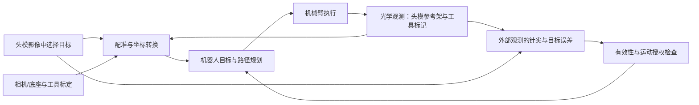

# 实物接入前研究：光学定位、头模、机械臂与误差

**实施后更新（2026-10-23）：本文保留开工前的设计与当时边界；“尚未实施”不再表示最新状态。** 现已完成 MR 头模＋模拟光学坐标链、刚体配准／独立检查点、离线误差与真实 MoveIt/mock 首轮执行，见 [本轮成果](NAVIGATION_BENCHMARK_RESULTS_2026-10-23.md)。真实光学、实体计量和实物精度仍未验证。

日期：2026-10-23。状态：**已核对现有代码和第一轮官方资料，完成问题筛选与研究设计；下述头模／光学模拟实验尚未实施，未获得实物数据。** 用户要求先探索接实物后会出现的问题，再选择现阶段值得提前处理的部分。

后续更新：用户要求先查已有平台的研究与公开 benchmark。已完成 [平台与数据选型](research/BASELINE_REVIEW_2026-10-23.md)。本文的几何链与实物问题继续有效，执行顺序改为先复现外部数据和原评价，再做本项目头模误差实验；本文假设参数扫查目前不是已批准的误差归因结论。

## 1. 对已有结果的定位修正

机械臂目前完成的是通信、规划与 mock hardware 执行的基础联调。`slicer/ur12e_panel.py` 的 `build_scene()` 会清空场景并建立机械臂、工具和目标；没有加载头部影像。`BASE_TO_RAS_MM=np.eye(4)` 假定影像显示空间与机器人空间同轴同原点。

机器人反馈的针尖由模拟关节、同一 UR 模型和固定 120 mm 工具长度计算，见 `ros2_ws/src/ur12e_slicer_bridge/ur12e_slicer_bridge/node.py:feedback()`。`validation/slicer_acceptance.py` 的独立计算指独立重算距离和角度，**不是来自独立光学测量的实物精度验证**。此前 1.205 mm／1.121° 包含规划容差下的软件目标跟随误差，不包含影像配准、光学测量、真实工具或机器人绝对定位误差。

仓库的头部影像／点配准练习与机械臂联调尚未合并；没有实体头模实验。`data/MR-head.nrrd` 与 `data/CT-brain.nrrd` 是两个独立公开样例，不能默认已互相配准。下一阶段先选一份影像建立虚拟头模，不将其视作已验证解剖模型。

已有运行证据保留在 [RESULTS.md](RESULTS.md)。其证明范围仍成立；项目整体状态应表述为“基础联调完成，光学参与的影像导航链尚未验证”。

## 2. 实际系统需要获得什么信息

机械臂最终仍需要自己底座坐标中的目标位姿。这个位姿应来自影像目标、影像与头模的配准，以及光学观测和外部标定的共同转换。光学设备观测的是标记架；目标解剖位置和针尖位置还需要相应标定才能求得。[SlicerIGT 教程](https://www.slicerigt.org/wp/user-tutorial/)分别提供回放、坐标转换、工具枢轴标定、标志点配准与光学跟踪教学。



这是待实现的架构。图中误差检查和运动授权如何反馈到控制器，需要按延迟、停止行为及实际应用要求验证；当前没有自动光学纠偏控制器。

## 3. 接实物时可能暴露的问题

| 环节 | 具体问题与表现 | 当前模拟为何看不见 |
|---|---|---|
| 影像→头模参考架 | 配准点定位偏差、点分布差、左右轴或变换方向错误；拟合点很好而目标区域仍偏 | 当前直接使用机器人坐标，未估计影像配准 |
| 相机→机器人底座 | 外参未知；相机或底座移动后旧标定失效；采样姿态不足导致参数不可靠 | 当前没有相机和外部标定 |
| 标记架→工具尖端／轴 | 标记中心不是针尖；工具换装、长度与轴向误差、安装松动 | 使用精确给定的 120 mm 模拟长度 |
| 机器人自身模型 | 具体机器的出厂运动学校准与通用模型不同；机器人报告位姿与外部测量不同 | mock 与可视化共用同一模型 |
| 光学观测 | 标记遮挡、超出有效区域、身份或质量异常；参考架相对头模松动 | 当前来源只有模拟 joint／TF |
| 时间对齐 | 头模、工具、关节数据不同步；旧帧重新到达或软件发布旧数据时戳 | 只检测状态文件更新不足以证明采集时间有效 |
| 目标与场景变化 | 头模移动后目标、障碍和旧计划的关系改变 | 静态空场景和简单盒体不覆盖这个问题 |
| 真实执行 | 速度滑块、保护停止、外部控制程序状态、负载与工具配置、通信抖动 | mock 普通关节控制器没有复现全部真实控制器行为 |

依据：UR 官方说明必须提取具体机器的出厂标定来修正 ROS 模型；此标定不能替代外部相机、工具或影像配准。[UR 标定](https://docs.universal-robots.com/Universal_Robots_ROS2_Documentation/doc/ur_robot_driver/ur_robot_driver/doc/installation/robot_setup.html)。UR 控制器文档解释了速度缩放、程序暂停和保护停止对轨迹执行的影响，真实阶段需重新核对控制器选择与完成判定，不能直接继承 mock 的普通 JTC 结论。[UR 控制器](https://docs.universal-robots.com/Universal_Robots_ROS2_Documentation/doc/ur_robot_driver/ur_controllers/doc/index.html)。

## 4. 现阶段优先研究的三项

以下优先级是基于“影响核心目标、可在无硬件时验证、产物能被实物接入直接复用”的工程判断。

### P1：完整坐标链与标定接口

**要回答：** 影像中的一个目标，经过模拟光学观测和各项标定后，是否仍变成正确的机器人目标；各变换由谁提供、何时失效。

先明确影像 I、头模参考架 H、相机 C、底座 B、机器人安装端 F、工具标记 M、针尖 Tip 各自的定义。每一项标定记录方向、单位、数据来源、适用设备和安装版本。Slicer 内部 RAS 与常见文件 LPS 之间有前两轴符号变化，必须显式处理。[Slicer 坐标约定](https://slicer.readthedocs.io/en/5.10/user_guide/coordinate_systems.html)。

**下一步可实施：** 单份公开头部影像中的目标与检查点＋非零旋转和平移＋模拟头模／工具光学流＋现有 UR12e 后端。为仿真建立独立保存的真值，不用估计链自身生成“验证真值”。先验证静态、头模改变姿态、相机坐标变化和工具换装几个场景。

**应交付：** 坐标链图、标定接口表、Slicer 头模场景与回放、真值和估计分离的数值记录。无误差情形先按数值精度验证几何关系，再加入测量误差；两者的通过条件分开制定。

**实物依赖：** 相机／标记类型、头模参考架安装、工具标记安装、底座是否被跟踪。拓扑未确认前不指定唯一手眼算法，也不把所有未知量塞进一个“手眼矩阵”。

### P2：标定误差如何传到目标，以及怎样独立验收

**要回答：** 哪项误差最影响目标；有限时间应优先改善点布局、工具标定、外参还是测量时序。

分开处理随机抖动、固定偏差、姿态相关误差和安装后突变。先单项扰动，再研究联合扰动及相关性；未经验证不把所有误差简单相加或作独立均方根合成。工具长度会放大角度误差：仅作几何举例，120 mm 的力臂偏转 1°，横向位移约 `120×sin(1°)=2.094 mm`。这不是本机实测误差。

用未参与配准／标定的目标点与姿态做检查，报告目标区域的误差分布、最大值和朝向／轴线误差。FRE 是拟合标志点的残差；它小不保证目标误差 TRE 小，点布局与目标位置需要单独研究。[Fitzpatrick 等，1998，摘要核对](https://pubmed.ncbi.nlm.nih.gov/9874293/)。

**外部基线先行：** 先用 ETH ASL 真实姿态流与作者方法研究时空标定，核查 LARK 公开头模数据／评价和许可，借用 NousNav 的分层验收与 UR10/Polaris 的独立最终测量思路。具体选择、证据和限制见 [baseline 报告](research/BASELINE_REVIEW_2026-10-23.md)，尚未复现这些数据的算法指标。

**之后可实施：** 在 P1 场景内扫查点布局、光学位置／角度扰动、工具偏置、外参偏差；所有输入先标为假设参数，不冒充设备指标。虚拟真值用于评估方法；实体头模阶段再使用独立检查点与测量链，记录检查工具自身的不确定性。

**应交付：** 误差来源表、目标区域误差图、敏感性排序和采样／验证建议。还未测量实际设备，当前不承诺最终能达到几毫米，也不将第一轮 2 mm 预算沿用为真实导航要求。

### P3：光学数据的时间、有效性与运动授权

**要回答：** 软件收到的是何时采集、是否仍有效的姿态；任何一项失效时，是否仍可能执行过期目标或继续旧计划。

每个头模／工具观测至少保留来源与标记身份、坐标方向、采集时间及其时钟域、接收时间、序号、有效标志和标定版本；质量指标以设备实际提供的字段为准。Plus 的记录格式同时包含采集时间和每个变换的有效状态，说明“能读到一个矩阵”与“这个观测有效”需要分开。[Plus 记录格式](https://pluslib.readthedocs.io/en/latest/file-formats/FileSequenceFile.html)。实际在线传输是否保留这些字段，仍须针对所选设备与消息格式核验。

**下一步可实施：** 回放有效流、单个参考架遮挡、流停更、时间错位、乱序、标记身份变化、参考架移动、标定版本改变。头模和工具的不同采集时刻不能直接当同一时刻相乘。现有 5 s 界面停更提示和仅禁用按钮不足以充当导航运动保护机制。

**应交付：** 可回放的观测协议、后端执行许可状态机、拒绝旧计划／目标的记录。规划后坐标关系或标定版本改变应使旧计划失效；中断后先重新验证并规划。运动中失效要验证取消命令和实际停止反馈，分别记录检测、请求取消和观测到停止的时间。软件取消不是机器人硬件安全功能的替代。

**暂定边界：** 第一阶段采用失效后暂停／使计划失效并重新规划的策略研究；头模运动下的自动跟随和光学伺服另行研究，不默认开启。时限要由误差预算和实测延迟确定，不任意宣称某个固定毫秒数足够。

## 5. 第一项完整场景的设计

下一项应验收的是：**在 Slicer 头部影像中选目标 → 模拟光学观测头模参考架与工具标记 → 经标定链生成机器人目标 → 规划执行 → 用独立保留的仿真真值和模拟外部观测检查针尖／轴线与目标的关系。**

它还要展示：非单位坐标转换、已知误差注入后的偏差变化、头模姿态变化使旧计划失效，以及单个跟踪对象失效时拒绝执行。加载头模只提供几何载体；这四项行为才开始检验导航链。当前没有实施这些新增场景。

下一轮不进行实体头模接触或侵入操作。实体阶段首先获取设备信息和只读状态，再按团队安排进行后续受控实验；实际用途和允许误差尚待场景定义。

## 6. 技术附录：一种待验证的坐标链

统一定义 `T_A_B` 将 B 中的坐标转换为 A 中的坐标，矩阵从右向左作用，所有平移使用同一长度单位。G 是影像中定义的目标位姿。

```text
目标给机器人：T_B_G(t) = T_B_C · T_C_H(t) · T_H_I · T_I_G
光学针尖相对头模：T_H_Tip(t) = inverse(T_C_H(t)) · T_C_M(t) · T_M_Tip
机器人模型预测针尖：T_B_Tip_kin(q) = T_B_F(q) · T_F_Tip
```

`T_H_I` 来自影像与头模参考架配准；`T_C_H`、`T_C_M` 来自光学；`T_M_Tip` 来自工具标定；`T_B_C` 来自外部标定；`T_B_F(q)` 来自具体机器的运动学模型。

这个版本假设相机与底座相对固定且参考架与头模刚性固定。相机移动会使固定的 `T_B_C` 失效。如果底座也有被跟踪标记 R，另一种方案是 `T_B_C(t)=T_B_R·inverse(T_C_R(t))`，仍需知道底座到标记的安装标定，不能自动省去标定。真实拓扑未明确，两个方案目前均为候选。

工具枢轴标定主要确定标记到尖端的点偏置；工具轴向和机器人安装端关系仍需相应观测／标定，不能把一个点标定等同于完整工具位姿标定。SlicerIGT 及其研究团队提供了相应工具标定演示。[工具标定演示](https://www.robarts.ca/computerassistedsurgery/demonstrations/calibration_of_ultrasound_and_tools.html)。

## 7. 本轮结果与下一步

- 已完成：代码证据核对、官方资料初查、误差环节拆分、三项优先研究方向和头模场景验收设计。
- 未完成：新头模场景实现、误差扫查、模拟光学流、真实外参／工具标定、实物测量。
- 优先顺序（本日后续更新）：外部平台／数据审计（完成）→ 原方法／评价基线复现（待开展）→ P1 坐标链与头模载体 → P2 有依据的误差研究；P3 的观测字段和计划失效规则从接口设计时同时纳入。算法比较和界面优化后移；退出异常保留为并行工程维护项，不作为导航研究的主线。
- 后续需要的设备事实：光学型号／SDK与可取得的姿态记录、参考架安装位置、工具及标记几何、UR 控制器与实际标定、目标操作与误差要求。当前概念和离线设计不依赖这些信息全部到齐；真实指标、驱动与标定方法不能提前定死。
